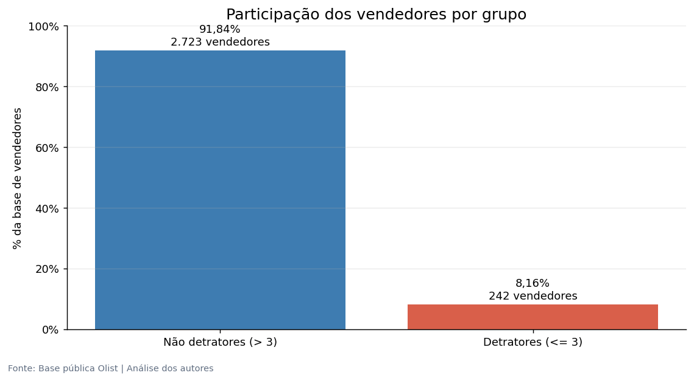
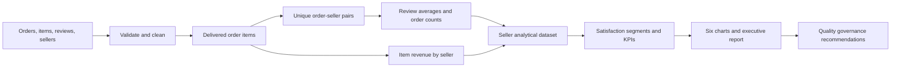
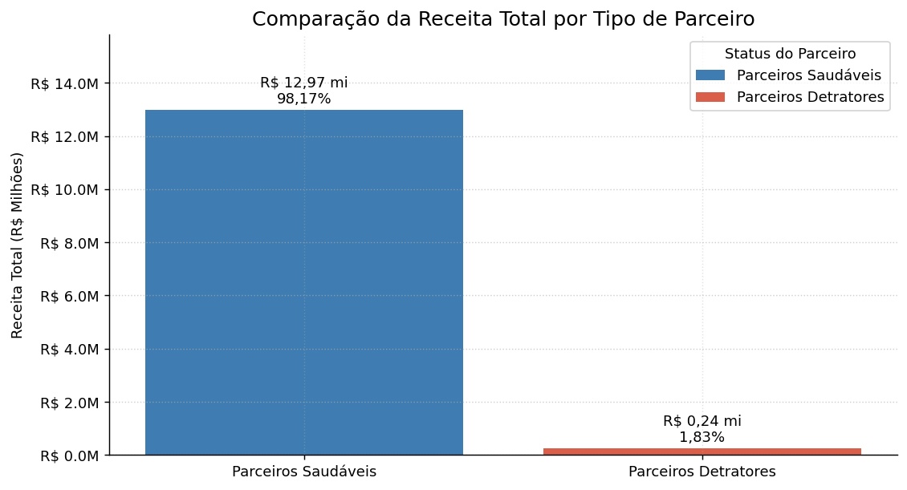
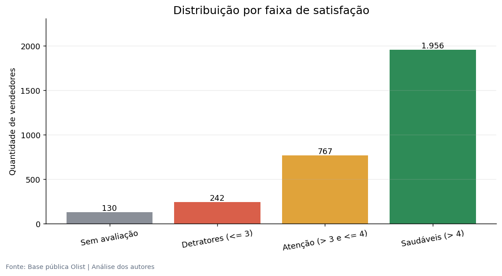

# Olist Marketplace | Seller Satisfaction & Business Performance

**FIAP Tech Challenge · Phase 1 · Data Analytics & Executive Decision Support**

An analytical study connecting customer reviews, seller performance, and commercial relevance in the Brazilian Olist marketplace. Four transactional datasets become a seller-level analytical view, six visualizations, and an executive report with recommendations for partner quality governance.

**242 low-rated sellers represented 8.16% of rated sellers, but only 1.83% of analyzed item revenue.** The project makes that exposure measurable and translates the findings into differentiated actions for seller segments.

[Executive report](docs/tech-challenge-phase-1-executive-report.pdf) · [Video presentation](https://youtu.be/-cpJJs3xU7M) · [Analysis notebook](Analise_vendedores_baixa_nota_V01.ipynb)



## Business question

How commercially relevant are low-rated sellers, and how can customer satisfaction data guide partner quality decisions?

The analysis connects the size of the seller segment, its contribution to orders and revenue, and its review performance. The executive narrative discusses reputational risk; the quantitative analysis measures observed commercial exposure rather than estimating a causal impact on brand trust.

## Skills demonstrated

| Competency | Evidence |
|---|---|
| Business problem framing | Translating marketplace trust into seller, order, revenue, and satisfaction indicators |
| Python and pandas | Domain-specific filtering, validation, deduplication, joins, and missing-review handling |
| Analytical data modeling | Separating order-seller satisfaction from item-level revenue to preserve each metric's grain |
| Exploratory and descriptive analysis | Segment summaries, participation metrics, satisfaction bands, and scenario comparisons |
| Data visualization | Six Matplotlib charts with consistent labels, colors, percentages, and BRL formatting |
| Executive communication | A 15-page report, recorded presentation, consolidated findings, and actionable recommendations |

Seller classification follows explicit business rules. Predictive machine learning is demonstrated in [Phase 2](https://github.com/joaomottin/TechChallenge-Fase2).

## End-to-end workflow



### 1. Load and understand the data

Source: **Brazilian E-Commerce Public Dataset by Olist**, available on [Kaggle](https://www.kaggle.com/datasets/olistbr/brazilian-ecommerce).

| File in `data/` | Original rows | Role |
|---|---:|---|
| `olist_orders_dataset.csv` | 99,441 | Order status and delivery confirmation |
| `olist_order_items_dataset.csv` | 112,650 | Order-seller relationships and item prices |
| `olist_order_reviews_dataset.csv` | 99,224 | Customer review scores |
| `olist_sellers_dataset.csv` | 3,095 | Seller registry and location fields |

### 2. Apply explicit quality rules

- Keep orders with `order_status == 'delivered'` and a populated customer delivery date: **96,470 orders**.
- Keep review scores from 1 to 5 and the first review per `order_id`: **98,673 review records**, before restricting to delivered orders.
- Keep items with a seller identifier and `price > 0`.
- Check seller city and state completeness in the registry.

### 3. Build metrics at the correct grain

Satisfaction uses distinct `order_id + seller_id` pairs before joining reviews. A multi-item purchase therefore contributes one review per seller, instead of giving the same review extra weight for each item.

Revenue is calculated separately as the sum of item `price`. It represents merchandise value in BRL, excluding freight, rather than Olist's net revenue or profit.

The seller view contains `total_pedidos` (distinct delivered orders per seller), `media_nota` (mean review score), and `receita_total` (item revenue).

| Population | Sellers | Use |
|---|---:|---|
| Full registry | 3,095 | Satisfaction bands, including unrated sellers |
| Sellers with delivered orders and revenue | 2,970 | Operational analytical population |
| Sellers with a valid review average | 2,965 | Binary satisfaction comparison |

Five sellers in the operational population have no valid review. The full registry contains **130 sellers without a score in the analytical view**, including sellers outside the delivered-order population. These counts describe different populations.

### 4. Segment satisfaction

| Segment | Rule | Sellers |
|---|---|---:|
| Low-rated / detractor | `media_nota <= 3` | 242 |
| Watchlist | `3 < media_nota <= 4` | 767 |
| Healthy | `media_nota > 4` | 1,956 |
| Unrated in the analytical view | No available seller average | 130 |

The binary comparison combines watchlist and healthy sellers into **2,723 non-detractors**. “Detractor” is the project's label for low review averages. The dataset uses a 1-to-5 review scale and contains no formal Net Promoter Score question.

## Results and business interpretation

| Indicator | Result |
|---|---:|
| Detractor share of rated sellers | 8.16% |
| Detractor share of seller-order counts | 0.91% |
| Detractor share of item revenue | 1.83% |
| Detractor item revenue | R$242,046.90 |
| Non-detractor item revenue | R$12,971,374.43 |
| Average seller score, all rated sellers | 4.18 / 5 |
| Average seller score, excluding detractors | 4.35 / 5 |
| Average item revenue per non-detractor | Approximately R$4,764 |
| Average item revenue per detractor | Approximately R$1,000 |

Better-rated sellers generated approximately **4.76 times** as much average item revenue per seller in the observed data. Most analyzed revenue lies outside the low-rated segment, supporting a targeted approach to quality management.

Order participation uses the **sum of each seller's distinct orders**: 891 for detractors and 96,915 for non-detractors. An order involving several sellers can appear in several seller counts; these totals represent seller-order activity.

The satisfaction comparison is an unweighted average of seller averages. Excluding a segment changes the calculation by construction; it does not demonstrate that suspending sellers would cause the same improvement in future satisfaction.

## Visual analysis





| Figure | Analytical purpose |
|---|---|
| [Seller share](docs/images/seller-share.png) | Size of the rated seller segments |
| [Revenue by segment](docs/images/revenue-by-segment.png) | Commercial exposure |
| [Delivered seller-order counts](docs/images/orders-by-segment.png) | Operational participation |
| [Average satisfaction](docs/images/average-satisfaction.png) | Descriptive comparison with and without detractors |
| [Satisfaction bands](docs/images/satisfaction-segments.png) | Healthy, watchlist, detractor, and unrated populations |
| [Revenue per seller](docs/images/revenue-per-seller.png) | Average commercial contribution |

The six standalone images preserve the existing notebook figures. Chart labels and the original report are in Portuguese.

## Executive deliverables

The [15-page executive report](docs/tech-challenge-phase-1-executive-report.pdf) develops the business context, methodology, charts, findings table, conclusions, and recommendations. The [recorded presentation](https://youtu.be/-cpJJs3xU7M) communicates the case to a business audience.

The proposed policy differentiates seller groups:

1. **Detractors:** investigate low ratings, set an improvement period, and consider suspension or removal if performance fails to recover.
2. **Watchlist:** provide training, clear communication, and measurable improvement goals.
3. **Unrated sellers:** monitor review coverage before drawing conclusions about quality.
4. **Ongoing governance:** review satisfaction, order activity, revenue, and segment movement together.

These are recommendations from the study, without a measured implementation outcome. Small review counts and order-level feedback shared across sellers should inform any individual seller action.

## Reproduce the analysis

From the repository root:

```bash
python -m venv .venv
```

Activate with `.venv\Scripts\Activate.ps1` in PowerShell or `source .venv/bin/activate` on macOS/Linux, then run:

```bash
python -m pip install pandas matplotlib notebook
python -m notebook Analise_vendedores_baixa_nota_V01.ipynb
```

Keep the four CSVs in `data/` and execute the cells in order. Charts are displayed in the notebook; documentation PNGs are separately extracted copies. Dependencies are not version-pinned, so package versions can affect reproduction.

## Repository guide

```text
Analise_vendedores_baixa_nota_V01.ipynb   Preparation, metrics, and charts
data/                                  Four source CSVs
docs/
  tech-challenge-phase-1-executive-report.pdf
  images/                              Six existing notebook figures
README.md                              Project narrative and execution guide
```

## Project series

| Phase | Focus | Repository |
|---|---|---|
| 1 | Business analytics and executive recommendations | [Olist seller analysis](https://github.com/joaomottin/TechChallenge-Fase1) |
| 2 | Supervised learning and imbalanced classification | [Wine quality](https://github.com/joaomottin/TechChallenge-Fase2) |
| 3 | AWS data engineering, PySpark, and analytical reporting | [State of Data Brasil](https://github.com/joaomottin/TechChallenge-Fase3) |

## Team

Developed collaboratively for FIAP.

| Contributor | Student ID |
|---|---|
| Felipe Macedo da Silva | RM373436 |
| João Pedro Mezzadri Mottin | RM372545 |
| Miguel Fernandes Martins de Bastos | RM373815 |
| Thanael Butewicz | RM373935 |
| Verônica de Fátima Machado Silva | RM371976 |
